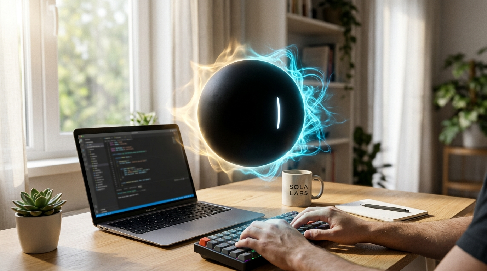
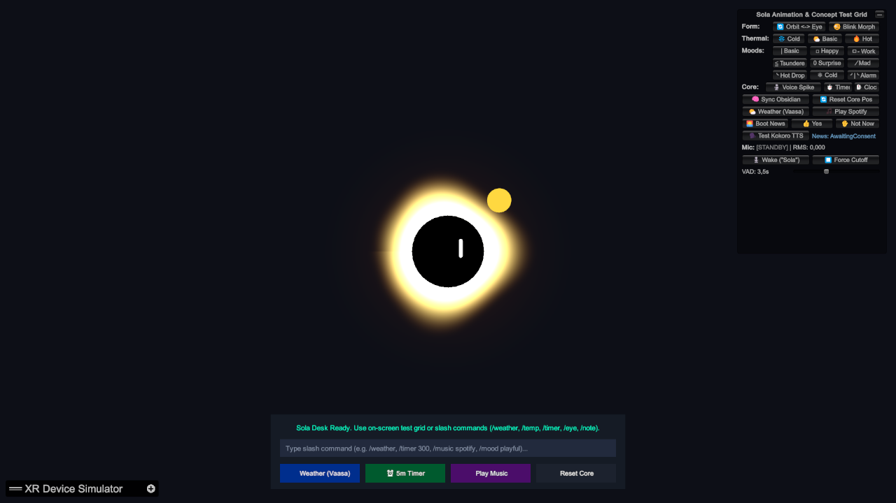
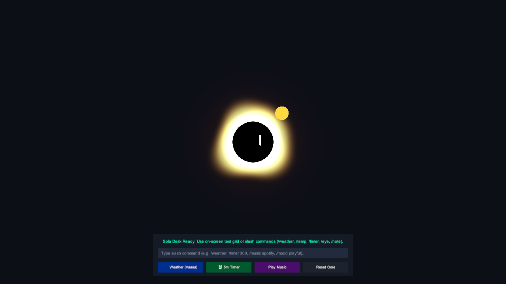
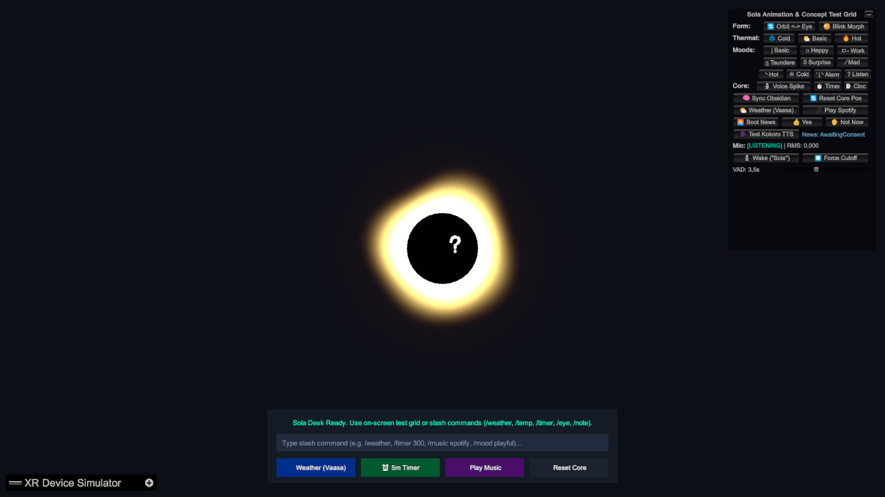
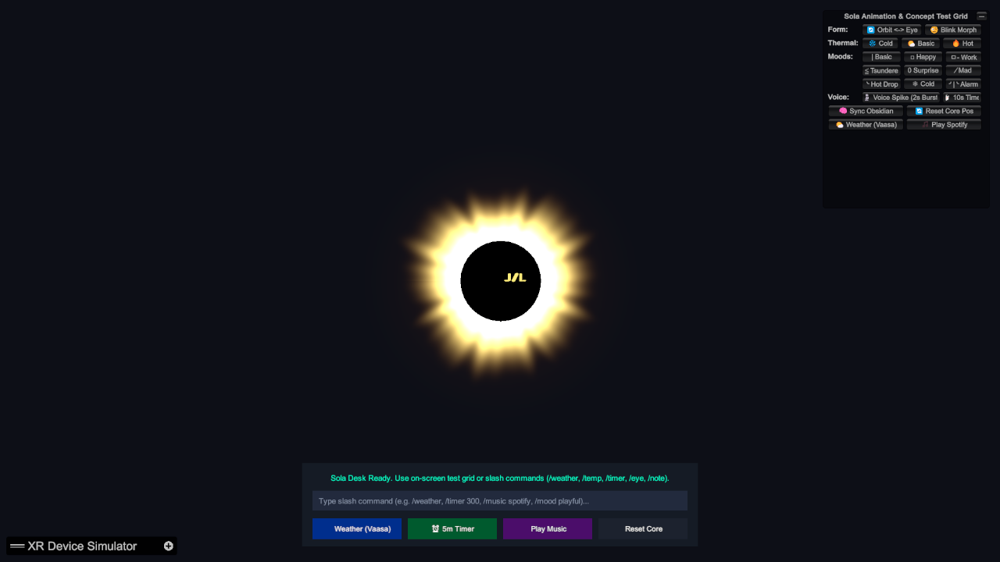
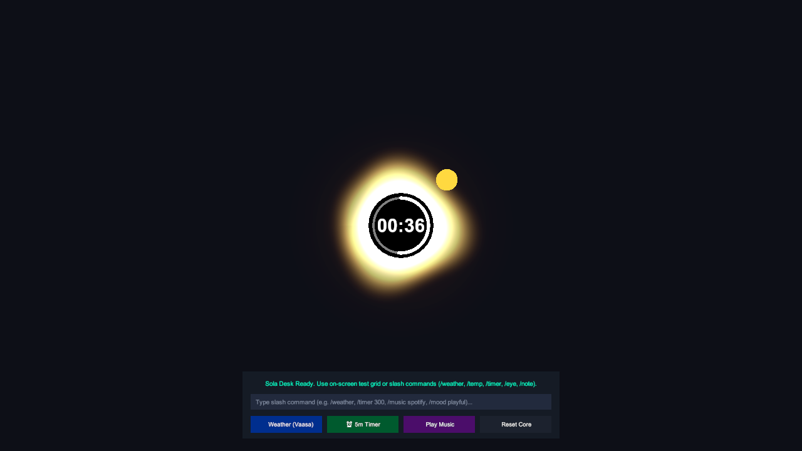
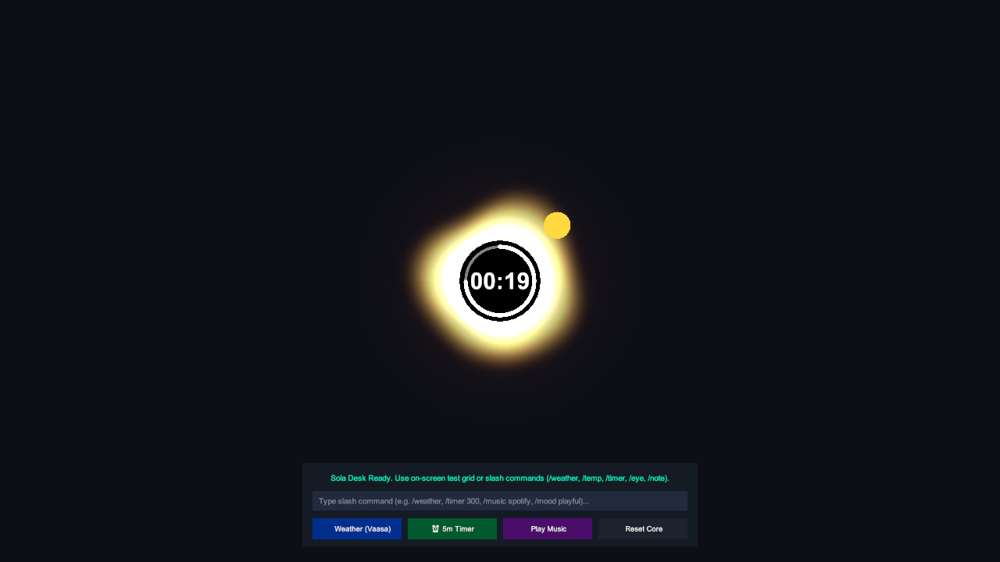

# 🌑 Sola: Autonomous Mixed Reality AI Companion

  

  
  
  
  
  

---

## ✨ Meet Sola

**Sola** is an autonomous spatial intelligence and multimodal AI companion that lives in your physical room in Mixed Reality. Powered by **Google Gemini 3.5 Flash Lite** and standalone on-device neural speech synthesis, Sola floats beside your desk, listens hands-free, expresses 10 distinct affective moods, and proactively organizes your day—all with **zero subscription fees** and **zero cloud intermediaries**.

Unlike traditional voice bots that require controllers and suffer from long awkward pauses, Sola features an instant **Fast Reflex (<100ms)** visual corona pulse and 100% on-device emotional dynamics.

---

## 🌟 Key Features

### 🎙️ Hands-Free Voice Activation & Dynamic VAD
Just say **"Sola"** or **"Hey Sola"**. Sola wakes with a gentle procedural chime, focuses its gaze on you, pulses in electric cyan, and automatically detects when you finish speaking using dynamic RMS voice activity detection. No buttons, no controllers, no friction.

### 🎭 Modular 10-Mood Emotional System
Sola is an expressive companion with a rich emotional spectrum that morphs smoothly between moods:
* **`Basic` (`|`)**: Calm, attentive neutral slit tracking your movement.
* **`Happy` (`⏜`)**: Warm green arch celebrating completed tasks.
* **`Work` (`ㅁ-`)**: Sapphire glasses glyph when diving into focused work.
* **`Tsundere` (`≦`)**: Playful pink chevron for cheeky banter.
* **`Impression` (`0`)**: Golden circular ring when discovering new insights.
* **`Listen` (`?`)**: White question-mark hook when actively listening to your query.
* *Plus `Hot` (`╰`), `Cold` (`❄`), `Mad` (`∕`), and ringing `Alarm` (`╯|╰`).*

### 🌅 Proactive "Boot News" Morning Briefing
Start your day with Sola. On boot, Sola checks the time of day, scans your local tasks, pulls real-time weather from Open-Meteo, greets you, and asks:
> *"Good morning! Got a minute for a quick briefing?"*

Say **"Yes"** to hear a tailored conversational breakdown of your schedule, weather tips, and unchecked tasks. Say **"No"**, and Sola politely dismisses itself—while keeping an eye out for anything marked `#urgent`.

### ⏱️ Spatial Countdown Timers & Spherical Clock
Need a focus sprint? Ask Sola to set a timer. An in-core minimalist radial progress ring visualizes your time in 3D physical space, ringing with twin bells upon completion.

### 🔒 100% Private: Bring-Your-Own-Key (BYOK)
* **Zero Subscription**: Use your own free [Google AI Studio API key](https://aistudio.google.com/) (500 free requests per day).
* **Direct Client-to-Cloud**: Your headset communicates directly with Google's servers over HTTPS. No middleman servers, telemetry, or hidden proxies touch your voice or data.

---

## 🚀 3-Minute Quickstart Guide

### Step 1: Download Sola
Grab the latest pre-compiled build from the [**Releases Page**](https://github.com/AndreiLAB/Sola/releases/latest):
* **Meta Quest 3 / Quest 3S**: Download `SolaXR-Quest3.apk`.
* **Windows Desktop PCXR**: Download `SolaXR-Win64.zip`.

### Step 2: Install on Your Headset
1. Sideload `SolaXR-Quest3.apk` using [SideQuest](https://sidequestvr.com/) or the [Meta Quest Developer Hub](https://developer.oculus.com/meta-quest-developer-hub/).
   *(See [GETTING_STARTED.md](GETTING_STARTED.md) for step-by-step sideloading walkthroughs).*
2. On Quest, open your App Library, filter by **Unknown Sources**, and launch **Sola XR**.

### Step 3: Pair Your Free Gemini API Key (No Typing Needed!)
1. Open the [**Sola Web Companion**](https://andreilab.github.io/Sola/) on your phone or PC browser.
2. Enter your free key from [Google AI Studio](https://aistudio.google.com/).
3. In your Quest headset, simply look at the QR code displayed on your screen. Sola will scan it optically and pair instantly!

---

## 📸 Visual Showcase

| Hands-Free Voice HUD & VAD | Proactive Morning Briefing |
| :---: | :---: |
|  |  |
| *Real-time mic energy VAD, procedural chimes, and automatic cutoff* | *Morning briefing synthesizing Obsidian notes and live weather* |

| Attentive "Listen" Face (`?`) | Audio-Reactive Equalizer Corona |
| :---: | :---: |
|  |  |
| *Wake reaction glyph with electric cyan corona* | *FFT 64-band audio spectrum flare on speech* |

| White Spherical Live Clock | White Radial Countdown Timer |
| :---: | :---: |
|  |  |
| *Live spherical time ring inside Sola core* | *Spatial countdown ring with completion chime (`/timer 120`)* |

---

## ❓ Frequently Asked Questions

#### Sola isn't reacting to my voice on Meta Quest 3. What should I do?
When sideloading apps, the Android system microphone permission dialog can occasionally be suppressed by Horizon OS.  
**Fix**: In your headset, go to **Settings > Apps > Sola XR > Permissions** and ensure **Microphone** is toggled to **Allowed**.

#### Where are my notes stored on Quest without desktop Obsidian?
On standalone Meta Quest 3, Sola runs completely self-contained. It generates an autonomous markdown vault at:  
`Android/data/com.AndreiLAB.SolaXR/files/Vault/Inbox.md`  
You can also inspect, read, and manage your notes wirelessly using the [Sola Web Companion](https://andreilab.github.io/Sola/).

#### Is Google Gemini free to use?
Yes! Google AI Studio provides a free tier for `gemini-3.5-flash-lite` offering **500 requests per day (RPD)** and **15 requests per minute (RPM)**, which is more than enough for hours of daily conversation.

👉 **More questions? Read our full [FAQ.md](FAQ.md).**

---

## 🛠️ For Developers & Researchers

Looking for the complete Unity 6 source code, shaders, C# components, or research benchmarks?
* **Source Code & Development Hub**: [**AndreiLAB/SolaDev**](https://github.com/AndreiLAB/SolaDev)
* **Technical Architecture Reference**: [PROJECT_STRUCTURE.md](https://github.com/AndreiLAB/SolaDev/blob/main/docs/PROJECT_STRUCTURE.md)
* **Academic Thesis Archive**: [THESIS_CONTEXT.md](https://github.com/AndreiLAB/SolaDev/blob/main/academic/THESIS_CONTEXT.md)

---

## 📄 License

Sola is open-source software licensed under the permissive [MIT License](LICENSE).
